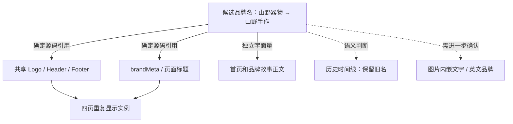
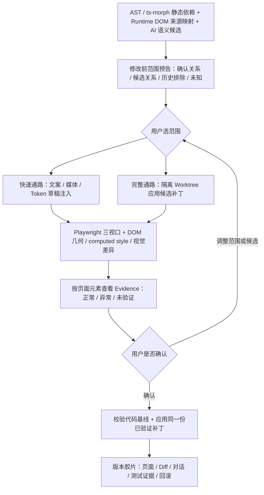

# Lovable 竞品深度体验、L1—L3 实验归档与 Ripple 产品设计输入

**研究版本**：v1.2（2026-10-16）  
**研究对象**：Lovable；对照对象：[Bolt.new 实测报告](https://github.com/Onesummer-D/Ripple/blob/main/docs/research/competitors/bolt-new/README.md)  
**研究项目**：Ripple｜Impact-aware Visual Editing（“尚未落笔，先见涟漪”）  
**研究材料**：研究者亲自操作的 Lovable 项目、连续截图、对话与 Timeline/Changes 记录、用户人工验收、Agent 输出的只读源码审计报告。  
**实验站点**：「山野器物 / SHANYE OBJECTS」中文生活方式品牌演示站；四个页面：首页、秋季活动、商品专题、品牌故事；九件商品，含筛选、详情、购物袋与模拟购买。  
**时间范围**：2026-10-15—16。**性质**：单项目、定性观察与局部任务验证，不能替代跨项目、跨账户、同仓库版本的控制实验。

> **研究判断**：Lovable 能生成可用的多页网站，能读取代码并理解部分共享依赖、业务语义和页面级覆盖，还在本轮展示了 Vitest、Playwright、截图读取、自我修复及版本/代码变化记录。需要研究的不是“Agent 有没有这些能力”，而是：在用户尚未正式应用修改之前，能否把**关系、影响、范围、候选视觉结果、证据覆盖和版本状态**组织成无需阅读执行日志即可理解和操控的一段体验。Ripple 应坚持 AST/ts-morph + Runtime 关联 + AI 语义候选 + 双通路预演 + Playwright + Evidence + 版本管理的融合路线，并用真实证据检验整体效果。

## 01｜研究方法：先划清证据和提示词边界

为避免把 Agent 的报告、用户实际见到的结果和技术推断混为一谈，采用以下证据标记：

| 标记 | 意义 | 不能越界推断的内容 |
|---|---|---|
| **O（界面实见）** | 用户操作并在 Lovable 页面看见按钮、日志、计时、代码 Diff、预览等 | 不能由按钮推定所有模式、所有项目都可用 |
| **T（Timeline/工具记录）** | Details 内 Read、Edited、命令、Thought 摘要、Looked at image 等可见记录 | “调用工具”不等于最终测试全部通过；不能假定用户在默认聊天区看到了该信息 |
| **A（Agent 报告）** | Lovable 对执行结果、检查、受影响文件或通过状态的说明 | 除非另有证据，不视为独立审计或人工验收 |
| **C（源码片段/只读审计）** | 用户截图可见的 diff、Agent 读到的源码和审计列出的路径/行号 | 仅对可见片段及明确检索范围成立，不等于研究者自行克隆仓库复核 |
| **M（人工验收）** | 用户在预览中实际检查，明确反馈符合任务需求 | 不能扩大为每个断点、每个交互状态的无缺陷证明 |
| **H（设计假设）** | 由实测现象导出的 Ripple 功能建议、概念图与流程 | 不是已交付的软件功能，也不是竞品测试结果 |
| **N（未验证）** | 未获得可检查的截图、运行输出、提交快照或端到端复现 | 不把“未见”说成“平台没有” |

**提示词强度是核心控制变量。** L1 是普通自然语言修改，L2 明确约束“只改商品专题页这一件商品”，L3 第一阶段显式要求**只读、找全引用、分析共享/语义关系、比较 A/B、不要修改、等候授权**，L3 第二阶段才有人为明确批准方案 B。因此，L3 的等待授权与完整分析是**提示词诱发的能力证明**，不代表 Lovable 在默认自然语言编辑时自动弹出同等决策流程。反过来，L1/L2 中部分定位行为虽已发生，但通常位于需手动展开的 Details → Timeline，而非默认对话区。两类现象必须同时记录。

### 可直接检验的研究问题

1. 在动手修改前，Agent 能否发现**结构共享**和**业务语义候选**，以及如何处理历史保护项？
2. 用户不打开 Details/Timeline 时，能否及时知道哪些页面**将改变**、哪些**不会改变**，是否仍可选择范围？
3. 构建、Vitest、Playwright、截图及 Agent 描述有没有被可靠绑定到**本轮代码版本 + 页面 + 视口 + 时间**？
4. 页面级覆盖、活动更名、全站品牌更名和版本回看究竟提供了哪些可复用的交互与技术经验？

## 02｜L0 初始站点生成与基础验收

### 任务与完成状态

初始提示词要求创建四页完整中文生活方式品牌网站「山野器物」，主营陶器、竹木器物、茶具及自然手工艺；强调东方生活美学、大幅摄影、米白/深棕/陶土色、中式衬线标题、留白和适当滚动动画，并配备手机菜单、九件商品、筛选、商品详情、购物袋和无需真实支付的模拟购买。

**人工验收通过**：四页可进入；九件商品具有名称、价格和图片；桌面导航及手机菜单可用；筛选、详情与模拟购买可操作；购物袋商品、数量及金额正确；未发现明显缺图、溢出、遮挡或运行错误。此处是该次用户验收结论，不应推广成“任意设备/全部交互状态均无缺陷”。

### Agent 内部行为的观察

- **主动素材制作（T/O）**：生成 Hero/陶艺过程等场景图，制作九宫格商品图，并以 Python/Pillow 按行列拆成九张商品图；可见对 React/TanStack 路由文件、共享组件、样式与测试的读取和写入。
- **失败恢复（T）**：执行日志出现 **`Failed: Editing 6 files`**，随后进一步检查样式、组件匹配和构建，继续编辑。初次中间失败与最终任务完成不能互相抹去。
- **验证（T）**：见到 Vitest 命令、Playwright Chromium 脚本、约 1440px 桌面及 390px 手机截图的读取记录。初始站点阶段有自动浏览器检查的具体活动记录；仍须逐项确认日志和图片是否来自所声称的版本。
- **可见成本（O）**：最终一次生成任务界面约显示 **9 分 37 秒、4.40 credits**。这是平台该次运行显示值，不等于规范化的人力时间、美元成本或与 Bolt 等价的计量单位。

**产品层观察**：站点视觉完成度属于用户对这次样本的主观评价（用户更偏好 Bolt 样本的生成效果），不能从两个不同提示词/不同实现的单次样本推导平台整体生成能力排名。Ripple 可借助成熟生成工具制作演示对象；本身不必定位为通用网站生成器。

## 03｜L1 全站秋季活动更名：普通自然语言任务

**任务**：把这一季的秋季活动改名为「秋日手作节」，同步本季相关宣传文字和活动展示，同时保持无关内容、品牌故事中的往年记录及商品业务功能。

**实测过程（O/T）**：Agent 先搜索全站中与活动相关的文本，并在 Details 中写出初步范围解释；截图中可见其点名活动页、首页的活动横幅及活动页 SEO 描述等需要变化的位置，并指出品牌故事中的 2023 年往年记录保留。随后编辑 `autumn.tsx`、`index.tsx` 等页面文件，多次 `Edited` 后检查构建状态，并编排 Playwright 浏览器核验（读取 H1、等待活动文案、截图及返回首页检查等）。可见总计约 **42 秒、1.30 credits**。

**默认界面观察（O）**：

- “先搜索后修改”的解释确实存在，但研究者**必须主动进入 Details/Timeline，展开任务，才看到完整文字和工具步骤**；不能写成 Agent 在默认聊天区清晰提示了所有受影响位置。
- 它未要求用户在正式编辑前确认 A/B 范围，也未以网页关系图、三视口对照或具体目标元素清单做成可交互的决策步骤。
- 结束后才在普通对话中提供可读的任务结果说明。**有执行前内部分析，不等于有面向用户的修改前告知和确认。**
- 可见 Playwright 脚本与调用，**当时未取得该轮完整的终端输出和实际生成截图**；不把“存在截图语句”升级为“用户收到完整视觉回归证据”。

**结果（A/O）**：平台报告本季活动内容与首页相应位置同步更新，往年历史保留；研究者观察页面显示与目标大体相符。若要对“所有相关表达式已覆盖”作严格结论，仍需保留 L1 当版源码和完整 Diff 复核。

**对 Ripple 的启示（H）**：提前给出已确认结构关系、业务关联候选、历史排除项和来源未知项；用户直接在网页上决定本次营销活动覆盖哪些位置，而非先读复杂 Agent 日志。

## 04｜L2 单商品角标：相同商品、不同页面范围

**任务**：**只在商品专题页**将「山石·提梁陶壶」（数据中为 `p1`）的「秋日新品」角标改为「秋日手作节」；商品专题页其他新品仍为「秋日新品」；首页/秋季活动页同一陶壶的角标仍为「秋日新品」，名称、价格、图片、购物流程不变。

### 内部实现及验证迹象

- 先读取 `index.tsx`、`autumn.tsx`、`products.test.ts`、`app-routing.test.tsx`、共享商品组件等（T）。
- 可见编辑 `products.tsx`、`products.ts`、`shop.tsx` 和新增 `product-badges.test.tsx` 等（T/C）。方案要点是**按商品专题页传入覆盖标签**，而不是直接改共享商品数据使所有页面一起更名。
- Agent 考虑到更长的角标宽度及组件渲染测试；运行 Vitest 后，Details 摘要显示 **15 项测试通过**（T/A）。中间可见 TypeScript 兼容性问题及修复讨论，不应删除失败/调整轨迹。
- 见到 Playwright 检查商品专题页、首页、秋季活动页，截图和 `Looked at image` 等操作，后续对两张角标近景、构建和类型检查再复核（T）。执行记录约 **2 分 02 秒、1.30 credits**。

### 用户真正得到什么

**人工页面核验（M）**：商品专题页陶壶角标为「秋日手作节」；该页其他有 `isNew` 的商品仍显示「秋日新品」；秋季活动页同款商品仍为「秋日新品」。原始站点并非九件商品都有角标，属于初始 `isNew` 状态不同，不是本轮漏改。用户反馈整体结果符合要求。

**UX 观察（O）**：本轮 **普通聊天区在执行过程基本没有连续说明**，直到结束才给出中文结果；详细读取、修改、测试及截图检视分散在需手动展开的 Timeline/Thought/Changes 中。不能说 Lovable 没有进行分析和验证，也不能把隐藏日志等同于普通用户已经看到了这些依据。

**重要误报场景**：商品页在滚动 Reveal / IntersectionObserver 动画下，未触发区域可能短暂透明。静态截图出现空白不必然意味着 DOM 缺失；需要滚动、等待动画、检查元素可见性及实际可点击性。正常响应式换行、菜单折叠和媒体裁切同样不应被机械判为风险。

**Ripple 输入（H）**：把当前商品位置、同源其他页面和未改范围一并呈现：`商品专题/p1：会变化`、`首页/p1：保持`、`秋季活动/p1：保持`，并允许切换仅实例/同源共享范围。局部覆盖要记录源规则、位置、例外和可回收性，避免无上限散落在条件表达式中。

## 05｜L3 第一阶段：只读源码分析 + A/B 范围决策

**候选任务**：「山野器物」拟更名为「山野手作」，但尚不修改。提示词明确要求检索完整中文名称、关联英文和历史文字，读取源码、测试、项目说明与共享组件，列出受影响位置，区分确定引用与业务语义猜测；比较 **A 仅首页** 与 **B 全站当前中文品牌**，并**等待授权**。

### 观察到的高价值能力（由强提示词触发）

1. **分析先于编辑（O/T）**：默认聊天区开头直接声明“本轮只读取，不修改”，Tools 中执行 `grep`、`rg` 与多文件 `Read`，还调用 Explore 子任务。最后在默认对话里给出较完整的分析报告，停止并等待用户选择 A/B。
2. **结构追踪（C/A）**：报告称检索到运行源码 **15 处「山野器物」字面量，分布于 6 个文件**，另有内部 `roadmap.md` 标题；特意指出共享组件在多页面重复渲染，**15 处字面量 ≠ 15 个屏幕显示实例**。这组数字是该次 Agent 在其搜索范围内的报告，不宜在取得源码快照前写成独立审计结论。
3. **共享与独立内容拆分（C/A）**：`src/components/brand/layout.tsx` 的 Logo、Header/Footer 与辅助阅读名称；`src/lib/brand-meta.ts` 四页标题/分享标题后缀；`src/routes/__root.tsx` 根布局；`index.tsx`、`products.tsx`、`story.tsx` 中的独立描述。修改共享 Logo 不等于修改所有独立文案，修改品牌后缀也不等于修改历史时间线。
4. **语义边界（C/A）**：普通词「山野」「器物」「手作」不一定代表品牌；英文 **SHANYE OBJECTS** 没有获得新译名，不应擅自修改；2018 年时间线旧名可以作为明确选择的保护项，但**不能据源码证明当年曾正式使用该名称**；2023 年活动历史仍需独立保护。
5. **方案对照（A）**：A 如果仅改首页正文，文件范围小；如包含首页 Header/Footer，就必须额外处理共享组件和页面上下文，否则波及四页或跨页名称不一致。B 则需同步当前品牌的共享标识、页面元信息和独立当前文案，并留下历史/英语/商品等例外。
6. **验证边界（A）**：分析明确提出最终仍需浏览器检查页面标题/分享信息、手机/桌面菜单、购物状态、历史文本和角标。源码关系并不直接证明布局安全。

**可见用时/额度（O）**：约 **2 分 07 秒、2.90 credits**。**重要限定**：分析在默认聊天区的首尾被清晰展示；具体文件读取和检索过程仍主要需要展开 Timeline。不能一概说 “Lovable 只在 Details 里分析”，也不能把这次强提示词测试当作默认产品能力。

### 结构关联示意（H，非 Lovable 自动生成图）

这张图应在 Ripple 中进一步区分 `SOURCE_CONFIRMED`、`SEMANTIC_CANDIDATE`、`EXCLUDED_BY_CONTEXT`、`SOURCE_UNKNOWN`；**确定引用 ≠ 语义相关 ≠ 应当修改**。

## 06｜L3 第二阶段：用户授权 B，全站当前中文品牌更名

**明确授权**：用户确认方案 **B：更新全站当前中文品牌「山野器物」→「山野手作」，保留英文 SHANYE OBJECTS、历史时间线与独立内容，并保持活动、商品和购买功能不变。**

**执行过程（O/T）**：默认聊天区先简要说明将按 B 范围执行；Details 可见 `Read AGENTS.md`、`shop.tsx`、`product-badges.test.tsx`、记忆读取，随后执行“核查更名范围与保留内容”“更新导航、页脚、当前品牌文案和页面信息，并检查测试”；可见阅读 `menu-390.png`、`desktop.png`、`roadmap.md`，执行后更改 `roadmap.md` 中任务状态，并报告完成。平台记录约 **2 分 28 秒、1.90 credits**。

**关键证据边界**：Timeline 的 `Read menu-390.png`、`Read desktop.png` 证实 Agent **查看了截图文件**，但截图可能属于更早版本或其他阶段，不能仅以 `Read` 判断这是本轮更名后重新运行 Playwright 得到的“新版截图”。必须核对截图文件生成时间与源码版本/浏览器 URL，或重新采集新证据。Agent 结尾所述“四页显示、手机菜单、模拟购买均验证”属于 **A 类平台报告**；用户后续亲自验收是另一份独立证据。

**最终人工结果（M）**：用户于 2026-10-16 明确确认 **L3 第二阶段五项最终人工验收全部通过**。本报告保留这一完整确认，不在缺少逐项原始勾选文字的情况下编造“五项名称及逐项浏览器截图”。从既有任务要求和 Agent 结果看，核查重点包含全站中文品牌一致性、历史/英文保留、活动和商品不被误改、手机菜单及购物交互；这些是**验收关注维度**，不能充当五项原始记录的逐条原文。

### 追加源码审计（A/C：Agent 只读报告，不是第三方重跑）

追加只读审计查找旧名、新名、英文名、共享布局、路由、文档、公开资产和测试。报告给出的结果：

- 网站**当前**中文品牌相关运行位置已更新为「山野手作」；SEO/页面分享元信息包括 `brand-meta.ts` 与 `__root.tsx` 在内按本轮范围同步更新。
- `story.tsx` 的 **2018 年历史条目**仍含旧名「山野器物」，属于有意保留的历史内容，不应作为未完成全站更名的运行缺陷。
- 英文 `SHANYE OBJECTS`、季节活动「秋日手作节」、2023 年「山野秋收」和商品角标/购买流程均报告未被意外更改。
- `roadmap.md` 的 `# 山野器物` 标题仍可作为内部文档的旧标题；不在用户授权的运行站点更名范围内。**属于可选择的后续文档维护，不是此次网站验收失败**。
- 图片中是否嵌有旧品牌字样、截图是否属于最新候选、跨视口完整视觉验证是否可复现，尚不能由源码关键词检索直接证成。

**这次 L3 最值得记录的事实**：Lovable 在**被要求先分析**时，已经能做相当仔细的共享引用定位、历史/当前语义判断、方案 A/B 影响解释并等待授权；在方案 B 获批后能完成修改，最终通过用户人工验收。待研究的问题是，能否把上述成熟能力转化为普通用户默认可见、可调整、且有最新视觉证据约束的范围决策界面。

## 07｜Lovable 产品界面的可复用设计与体验摩擦

### 已观察到的能力

- **统一工作区（O）**：Preview、Files、Code、More、设备/视口切换、独立预览、分享/发布等入口；不因操作方式与 Bolt 相似便推断功能完全相同。
- **Timeline + Changes（O）**：读取文件、工具命令、编辑成功/失败、局部 Diff、Thought 摘要、查看图片，均可逐项展开；Changes 视图可按文件查看红绿变更。
- **历史版本导航（O）**：历史节点菜单中有 `Open preview in new tab`、`View code changes`、`Go to message in chat`。这已经建立版本—源码变化—对话之间的跳转关系，不是“没有版本证据”。
- **测试/截图（T）**：初始生成和 L2 可见浏览器脚本、测试输出摘要和截图读取；这是实在的自动化活动记录，不可抹去。
- **成本与运行中状态（O）**：页面显示耗时与 credits，用量达到当日限额会阻断后续任务，隔日额度恢复。本次没有实际检验跨账号迁移，不能据此断言项目可无损迁移。

### 被动信息发现成本

L1 的部分修改前定位、L2 的大多数代码/验证行为都被包裹于 **Details → Timeline → 单项展开**。普通用户通常不会持续观看 Agent 如何逐步读写文件，更未必能读懂测试命令。因此本轮不是“信息不存在”，而是**执行证据的默认信息层级偏开发者工作记录**。但 L3 明确收到“只读报告”指令后，默认聊天区确实主动呈现了分析开场声明和完整结束报告；应逐轮分开判定，而非单一归纳。

**一个可检验的交互指标**：随机让用户在不展开 Details 的情况下回答：“本轮会波及哪几页？哪些是历史保护项？哪些浏览器视口实际上被新版验证过？当前修改是候选、已应用还是已发布？”测其准确率、展开层级与完成时间，而不是只问“平台有无相关功能”。

## 08｜Bolt vs Lovable：按相近任务比行为，不按营销印象排名

参照现有 [Bolt.new 正式实测报告](https://github.com/Onesummer-D/Ripple/blob/main/docs/research/competitors/bolt-new/README.md)：Bolt B02 共享导航全页同步、B03 页面级条件覆盖、B04 季节营销活动语义更新、B05 多设备预览、B06 版本历史、B07 先分析后执行局部角标。下表为**不同生成项目、不同源码结构、不同提示词强度下的定性横向比较**，不是同基线量化竞赛。

| 比较项 | Bolt 已观察到 | Lovable 已观察到 | 谨慎结论 |
|---|---|---|---|
| 四页网站生成 | 用户评价初始样本视觉更理想，具备响应式页面 | 四页九商品、素材生成/切片、购物交互，经用户基础验收 | 单样本主观观感，不得推断普遍质量优劣 |
| 普通跨页活动改名 | B04 能搜语义相关并报告六文件修改、保留历史 | L1 先搜业务文本，改活动页/首页及相关描述，保留 2023 历史 | 二者都表现出一定业务语义识别能力 |
| 共享组件/局部覆盖 | B03 按 `currentPage` 仅首页改名；B07 按 `product.id` 特判 | L2 通过页面级 badge 覆盖，只让商品专题 p1 不同 | 二者均能做局部 Scope；方案组织不同，长期维护未比较 |
| 修改前说明（普通任务） | 部分情形有事先解释；普通流程未见默认可视化影响图 | L1 有内部定位但主要隐藏在 Details；L2 默认聊天区执行期间基本不说明 | 不能概括为完全“不分析”；默认可感知性仍值得研究 |
| 强指令下先分析/等待授权 | B07 在指定只读分析时预测共享角标影响并等待用户确认 | L3.1 查 15 处/6 文件、A/B 范围与历史保护，等待 B 授权 | 两者都可做到；**提示词干预不可当默认能力** |
| 浏览器自动化证据 | B07 Agent 明确说该次不能直接执行浏览器截图；有用户人工核验 | 初始生成、L2 可见 Playwright、截图/图片读取与测试 | **在本次可见样本中** Lovable 的自动化活动证据更丰富；不是两平台永久能力断言 |
| 多视口 | Bolt 提供多设备预设并由用户人工切换 | Lovable 可见桌面/390px 手机等读图与检查；有设备切换 | 不能把任一家已有的手机预览/自动截图写成 Ripple 首创 |
| 版本与 Diff | Bolt 有 V1—V6、旧版预览、Restore 入口；真实恢复副作用未测 | Lovable History/Changes/文件 Diff，历史节点可链接预览、Diff 和对话 | 都有历史能力，差异应看证据与具体网页区域能否同版对齐 |
| 失败/修复透明度 | Bolt 有 Read/Edited/Built 等状态 | Lovable 初次生成出现 Failed Editing，后修复；L2 有类型/测试补救 | 自我修复是观察到的成熟能力，不是 Ripple 应回避的事实 |
| 项目接入 | Bolt 有 GitHub 入口，现有仓库导入未完成实测 | 本轮 Lovable 入口/流程主要见新建与导出到 GitHub；未实测已有仓库逆向导入成功 | 接入已有项目能力必须以**当前实际流程另测**，不要把未经复测的平台政策写死 |
| 端到端费用/耗时 | Bolt 未形成可复现的统一时间/消耗基线 | Lovable 有各轮任务屏幕计时与 credits | 没有同基线、同计量、同验收口径，不能直接排名“更快/更省” |

**尤其注意**：不能把 Bolt “未在 B07 跑出浏览器截图”概括成“Bolt 不支持 Playwright”；也不能把 Lovable “L3.2 读过 PNG”直接说成“该版已绑定最新视觉证据”。报告只写本次证据证明的事实。

## 09｜从实测转化为 Ripple 主交互：不偏离既定技术路线

### 目标叙事

用户在真实网页上发起一次候选修改，例如将当前品牌「山野器物」改为「山野手作」。界面**先**显示从文字源头发出的“结构涟漪”：一个共享 Logo 在四页分别呈现、`brandMeta` 对四页页面标题生效、首页/品牌故事的独立文案需要单独判断；2018 历史、英文名称和图片内未知文字不是默认全局替换对象。用户决定范围后，在**隔离候选环境**执行代码修改；再看 **1440 / 768 / 375** 三视口的“视觉涟漪”，识别正常变化、真实异常与未核实项；最后确认正式应用与版本记录。技术模块共同支持这段体验，不是各自成为一个孤立功能页。

### 工程流程（H：规划与局部原型能力，不代表完整交付）

这里“修改前”指**不提前污染用户的正式项目**；不代表无需在任何环境修改代码就能预测真实视觉效果。预告可以根据已知依赖给出潜在影响，**真实渲染视觉证据**须等候选在适当环境执行并采集。快速注入路径需检查与最终落盘效果等效；复杂共享组件、条件逻辑及布局更适合 Worktree 完整预演。

### 四项需要固定在产品方案中的设计决定

**D1｜关系分级，而非把同名文本视为同一来源。** `STRUCTURAL_CONFIRMED`：源码/运行时可证明的引用；`SEMANTIC_CANDIDATE`：业务语义相关但需用户判断；`EXCLUDED_BY_CONTEXT`：历史、独立内容等需要有意保留；`SOURCE_UNKNOWN`：图片内嵌文字、外部运行时内容等暂无法证实。关系可展开到来源、消费组件、页面路由、DOM 元素与证据等级。

**D2｜Scope 作用于展示实例与业务范围，不是只列文件名。** 同一 Logo 可以服务四页，用户仍可合理选择“只首页”“所有共享实例”“本季相关内容”“明确排除历史”；候选方案要解释是否需要新增页面条件或覆盖表，长期维护成本如何累积。

**D3｜三阶段不同：预告 → 隔离预演 → 正式应用。** 用户可以在试改前决定候选范围，试改后比较真实视觉，再决定是否应用。正式补丁应绑定基线 Commit/文件指纹；若基线漂移或截图过期，必须失效重验。不能用“预演了补丁 A”代替“正式重新生成补丁 B 后已验证”。应用也不等于已公网部署。

**D4｜可见的验证覆盖，而非默认宣称安全。** 把 `已通过浏览器检查`、`正常响应式变化`、`确认的异常`、`尚未验证`、`来源不明` 直观呈现。动画未触发、字体延迟、懒加载、滚动位置、购物袋状态应纳入截图前提；旧版截图不能作为新版证明。

### 证据与版本绑定契约（设计候选）

每份 Evidence 最低应包含：`evidence_id`、`project_id`、`candidate_id`、`base_commit_or_fingerprint`、`patch_hash`、`preview_build_id`、`route`、`viewport_css_width/height`、`device_scale_factor`、`captured_at`、`source_type`（真实浏览器/源码分析/人工/Fixture）、`target_dom_anchor`（稳定定位优先，非可靠时标 Unknown）、`artifact_path`、`check_kind`、`status` 与 `error_reason`。必要时另附滚动位置、动画/等待策略、登录/购物状态和关联日志。

**生命周期要求**：预演后改候选、改 Scope、源码基线漂移、设备改变或页面关键状态变化时，相应 Evidence 要标失效/待重验；不许保留绿色通过状态但偷偷指向旧截图。版本节点应能跳转到“当版页面区域 → 对应源码差异 → AI 解释 → 自动/人工证据”。`Fixture` 明确显示为演示数据，不能伪装成真实浏览器测试。

### 默认界面信息层次（H）

- **一级：影响概览**。屏幕上可见的“候选修改卡”，标出目标文字、主要受影响页面、明确排除项、待确认项；让普通用户能直接选 Scope、开始预演。
- **二级：视觉验证**。三视口同步聚焦受影响 DOM，切换前后、展示异常/正常/未覆盖；点击异常可反查源头。
- **三级：技术细节**。像 Lovable 一样保留 Timeline、Diff、命令、测试日志，但作为核查层而非决策界面的唯一信息源。

概念视觉稿中“山野器物 → 山野手作”的候选卡、分级关系树及完整流程，仅为**产品设计示意（H）**，不是当前 Ripple 分析引擎输出、也不是 Lovable 真正生成的影响图。

## 10｜与当前 Ripple 仓库原型的真实衔接

当前 Ripple 仓库的根 `README.md` 已描述：青野/栖光本地 Fixture、关系涟漪 UI、Scope 切换、草稿预演、三视口预览、部分 Chrome 验收、实时 DOM 几何/裁切/Token 观测、Evidence ID/JSON 下载、版本中部分实测样本，以及第三方适配器接口。**这是现有仓库自述和局部实现线索，不等于本报告亲自拉取运行了全套测试**。

因此，不应把上述所有功能一律说成“尚未开始”；也不能把 A 的本地 Fixture Evidence 写成 B 引擎已对任意外部项目完成 AST/Runtime 关联和版本一致性验证。后续开发须在既有原型上逐项接入、打通并复核：

| 模块 | 已有基础或已规划技术 | 此次竞品研究转成的下一步验收 |
|---|---|---|
| 关系层 | AST/ts-morph、Runtime、缓存/增量更新、语义检索 | 用真实 Lovable/Bolt 站及第三方无标记 React/Vite 站统计确认引用、语义候选、历史排除的准确与漏报 |
| 交互层 | 结构涟漪、页面 Slot 与 Scope | 在用户未给文件名的任务中，默认预告“将波及哪里”，提供可调整范围，不强迫阅读日志 |
| 预演层 | 草稿注入 + Worktree 隔离候选 | 同一候选在真实站上运行、截图、改变范围重验，正式应用同一 patch；对基线漂移安全失效 |
| 证据层 | Playwright、三视口、几何、computed style、视觉差异 | 每张截图绑定 Commit/候选/页面/视口/时间；模拟旧截图污染并确保不会误标“已通过” |
| 判断层 | Evidence 状态、规则解释 | 把动画未触发、正常菜单折叠、图片裁切与真正遮挡、溢出分开；让未知保持未知 |
| 历史层 | 草稿、版本快照/证据查看 | 历史节点可同步定位对应页面区域、差异、证据和对话，并实测恢复操作而非仅展示控件 |

### 主案例映射

**青野文创·秋日灵感季**继续承担主故事：真实编辑 → 共享和语义关联浮现 → 三视口视觉变化 → 解释证据 → 选择局部/关联范围 → 隔离重验 → 应用同一补丁 → 版本回溯。Lovable L1 的营销活动与 L3 的全站更名是**验证结构/语义分析和保护项**的优质补充案例；L2 则是**页面级 Scope 负例/对照**（同一商品在一个页面改、另一个保持）。不要把所有 L1/L2/L3 情节强行塞进主案例的 120 秒叙事，避免中心交互松散。

**栖光艺术节**继续承担同一媒体被不同布局消费的裁切压力测试；**第三方开源站**用于无专门标记的 Token/组件关联及适配边界。这两项不能被更名实验替代。

## 11｜下一轮可量化的公平对照

可选任务覆盖：普通自然语言跨页活动更名、同一商品仅单页角标覆盖、先分析再全站更名、图片横竖版替换、响应式正常变化负例、旧截图污染、真实故障/缺证据、第三方已有仓库导入。每个平台分别记录**普通提示**与**强提示**，不得让某个平台获得包含源码路径、检查命令和排除条件的“答案式提示”而另一平台只收一句自然语言。

统一度量：首次影响提示延迟；改前用户能正确说出的受影响区域比例；候选覆盖准确率/漏报率；确认前修改正式项目的次数；目标页/非目标页误改；三视口真实检查覆盖率；截图版本准确率；正常变化误报率；用户查看 Details 的点击/展开次数；从输入到可确认的时长与失败恢复成本；credits/token/硬件环境的实际记录。**没有统一实验条件就只记录原始值，不进行性能排名。**

## 12｜研究结论与后续归档事项

本轮最重要的发现不是一种现成技术是否“独有”，而是**能力存在、证据存在和用户在正确时间理解它们，是三件不同的事**。Lovable 已展示有价值的结构分析、语义判断、范围覆盖、自动测试、截图和版本记录；Bolt 同样具备共享组件理解、局部覆盖、多设备预览和版本历史。Ripple 的融合创新应把这些工程能力串成用户在正式修改前真正可以操作的决策过程，而不是刻意否定竞品，更不能因为每项单独存在成熟方案就放弃系统协同、效率和可解释性的技术价值。

**仍需补证**：① L3 五项人工验收各自的原始任务/截图/勾选明细（当前已有总体通过确认）；② L1 Playwright 终端完整结果；③ L2 截图/日志与代码提交版本的指纹；④ L3.2 所读截图是否为最新版；⑤ Lovable 导出 GitHub 后的完整代码审计（如用户授权并导出）；⑥ Lovable/Bolt 在**同一个仓库基线、同一组提示词与条件**下的控制实验。缺项不否定已有人工通过，也不允许在报告里自动补成“全验证”。

> **归档结果**：已在本轮本地研究归档包中整理 **62 张 Lovable 操作过程截图**（L0 20、L1 8、L2 11、L3 第一阶段 17、L3 第二阶段 6），并建立含原始文件名、分组、SHA256 的 `evidence_manifest.csv`。另外独立归类用户补充的 **8 张概念/研究批注图（H）及 1 张真实工具栏截图（O）**。按文件名时间段分组只是检索便利，不构成代码版本指纹或测试通过证据。这批 UI 原图未同步上传到公开 GitHub；GitHub 目前保存正式 Markdown 报告，截图在可下载的离线归档包中。